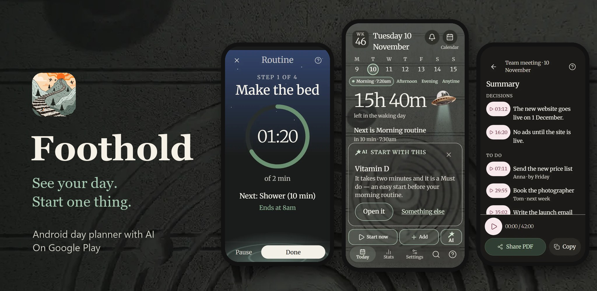

# Foothold

Android day planner for people who struggle to start (made with ADHD in mind): see your day, start one thing.

## Features

- Tasks of many kinds: workouts with timed rounds and spoken commands, routines, shopping lists, trips, meeting recordings
- Reminders on the minute and a home-screen widget
- AI help: say a task in one sentence, ask "What now?", plan a trip, sum up a meeting
- Free and Plus plans; on Google Play as "Foothold: ADHD Daily Planner"
- Built with Next.js and Capacitor, plus a Cloudflare Worker that calls Claude

<a href="https://footholdplanner.app/" class="md-button md-button--primary">Visit Foothold</a>
<a href="https://play.google.com/store/apps/details?id=app.foothold.planner" class="md-button">Google Play</a>
